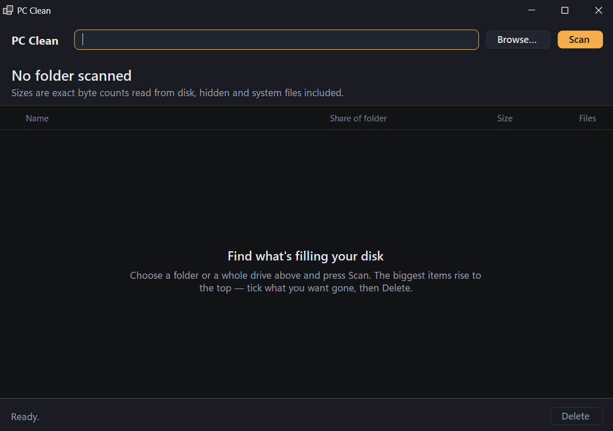
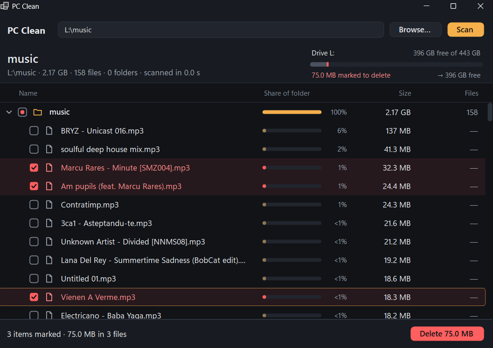
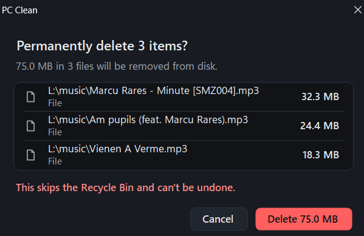

# PC Clean

**Find what's filling your disk, then delete it.** A small, dark, no-nonsense Windows
utility: scan a folder or a whole drive, see **exact** sizes in a folder/file tree
(biggest first), tick what you want gone, and permanently delete it.


## Download

Grab the latest build from [Releases](https://github.com/awwi-cmd/pc-clean/releases/latest):

| File | Size | Needs |
|------|------|-------|
| `PcClean-standalone-win-x64.exe` | ~50 MB | Nothing, runs on any 64-bit Windows 10/11 |
| `PcClean-win-x64.exe` | ~0.2 MB | [.NET 9 Desktop Runtime](https://dotnet.microsoft.com/download/dotnet/9.0) |

Single exe, no installer. Windows asks for administrator rights on launch (the app
relaunches itself elevated so it can read and delete protected files). The exe is not
code-signed, so SmartScreen may warn on first run: **More info → Run anyway**.

## Features

- **Exact sizes.** Real byte counts read from disk, hidden and system files included,
  aggregated bottom-up (folder = its files + all subfolders). No estimates.
- **Whole drives or any folder.** Type a path (`C:\`, `D:`, `C:\Users\me\Downloads`) or Browse.
- **Biggest first.** Each row shows its share of the parent folder, size and file count.
  Expand to drill in (chevron, double-click or arrow keys).
- **Drive meter.** Free/total space of the target drive, with the bytes you've ticked
  shown in red and the free space you'd end up with.
- **Tick and delete.** Ticking a folder ticks everything inside it. The Delete button
  shows the total.
- **Safe confirm.** An itemized dialog lists every target with its size before anything
  goes; it defaults to Cancel, so Enter never deletes by accident.
- **Progress and cancel** for both scan and delete.
- **Skips junctions, symlinks and mount points**: no loops, no double counting, and a
  delete removes the link itself, never its target.
- Inaccessible items are skipped and reported, the rest of the scan continues.

| Pick a folder | Tick what you want gone | Review before deleting |
|---|---|---|
|  |  |  |

> [!WARNING]
> **Deletion is permanent.** It skips the Recycle Bin and can't be undone. The app runs
> as administrator, so it *can* delete system files: check what you tick.

## How to use

1. Type or **Browse…** to a folder or a whole drive.
2. **Scan** (or Enter). **Cancel** stops it.
3. Tick files/folders (click the box, or Space).
4. **Delete**, review the list, confirm. The status bar shows what was freed and the
   new free space.

## Build from source

Requires Windows and the .NET 9 SDK (or newer). No NuGet packages.

```
dotnet build PcClean\PcClean.csproj -c Release
PcClean\bin\Release\net9.0-windows\PcClean.exe
```

Release builds:

```
# standalone single exe
dotnet publish PcClean\PcClean.csproj -c Release -r win-x64 --self-contained true -p:PublishSingleFile=true -p:EnableCompressionInSingleFile=true -p:IncludeNativeLibrariesForSelfExtract=true -p:DebugType=none -o publish\standalone

# small single exe, needs the .NET 9 Desktop Runtime
dotnet publish PcClean\PcClean.csproj -c Release -r win-x64 --self-contained false -p:PublishSingleFile=true -p:DebugType=none -o publish\small
```

### Test / CLI modes

Both run without elevation:

- `PcClean.exe --selftest` builds a temp fixture with known sizes plus a junction loop,
  verifies scan totals, checkbox cascade, permanent delete and bookkeeping, and prints
  `ALL TESTS PASSED`.
- `PcClean.exe --cli <path>` prints the tree with exact byte counts.

It's a GUI-subsystem exe, so capture output with
`Start-Process -Wait -NoNewWindow PcClean.exe --selftest -RedirectStandardOutput out.txt`.

## Notes

- Totals can differ from other tools on trees with reparse points, since those are
  skipped rather than followed.
- Locked/in-use files fail to delete and are reported; rescan for accurate sizes afterward.

## License

[MIT](LICENSE)
